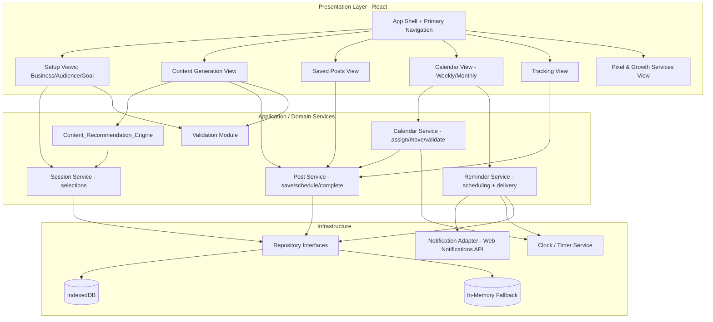
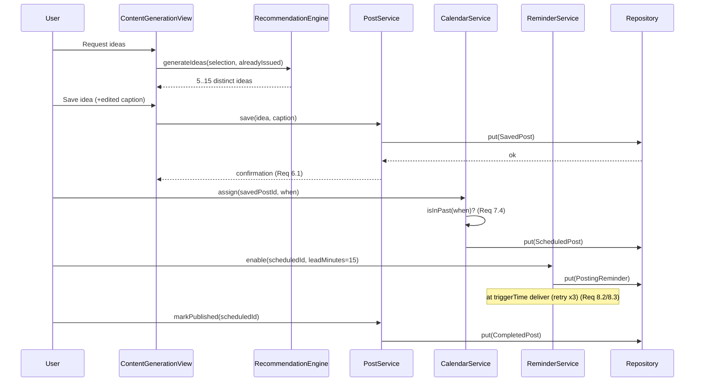

# Design Document

## Overview

Pixel Planner is a responsive, client-side web application that helps small-business owners plan, organize, and track social-media content. It walks the User through a short setup (Business_Type, Target_Audience, Content_Goal), generates tailored Content_Ideas and Caption_Suggestions through a Content_Recommendation_Engine, and lets the User save ideas, arrange them on a weekly/monthly Content_Calendar, set Posting_Reminders, and track Completed_Posts. A dedicated section introduces Pixel & Growth's marketing services.

The requirements imply local persistence (Saved_Posts, Scheduled_Posts, Posting_Reminders, Completed_Posts survive across sessions) and no mandatory backend. This design therefore targets a **single-page application (SPA) that runs entirely in the browser** with data stored in the browser via IndexedDB (with an in-memory fallback for private-mode or storage-denied environments). This keeps the product simple to build, host, and demo while satisfying the persistence, responsiveness, and accessibility requirements.

### Technology Stack

Chosen for simplicity, ubiquity, strong tooling, and testability:

| Concern | Choice | Rationale |
| --- | --- | --- |
| Language | TypeScript | Static typing catches data-model errors; excellent editor support. |
| UI framework | React (with Vite) | Widely used, component model maps cleanly to the view structure, huge ecosystem, fast dev server/build. |
| Routing | React Router | Client-side navigation for the four primary views + services section (Req 10). |
| Styling | CSS Modules + design tokens (CSS custom properties) | Enforces the constrained palette, typography, and spacing scale (Req 10, 11) in one place; no heavy dependency. |
| State | React Context + reducers (lightweight) | Session selections and view state; avoids over-engineering. |
| Persistence | IndexedDB via a thin repository wrapper (idb library), in-memory fallback | Structured, async, larger quota than localStorage; suits collections of posts/reminders. |
| Reminders/scheduling | Timer service backed by the Web Notifications API, with in-app fallback banner | Delivers reminder notifications (Req 8). |
| Testing | Vitest + React Testing Library + fast-check (property-based) + axe-core + Playwright | Unit, component, property, accessibility, and responsive/E2E testing (see Testing Strategy). |

Property-based testing (fast-check) is applied to the pure logic core (recommendation engine, validation, calendar/date rules, reminder time math, ordering, counts). UI rendering, branding, responsiveness, and accessibility are validated with snapshot/component tests, axe-core, and Playwright viewport tests rather than property tests.

### Design Goals and Non-Goals

- **Goals:** guided content setup, reliable local persistence, an uncluttered and consistent UI, strong accessibility and responsiveness, and a testable logic core.
- **Non-Goals:** real AI/LLM content generation (the engine is a deterministic template/combination system that can later be swapped behind an interface), multi-user accounts, server sync, and direct publishing to social networks.

## Architecture

Pixel Planner uses a layered client architecture. The **Recommendation Engine** and **Domain Services** are framework-agnostic pure(ish) modules so they can be property-tested in isolation; React sits on top as the presentation layer, and a **Repository** layer abstracts persistence.



### Key Architectural Decisions

- **Pure logic core, thin UI.** The engine, validation, calendar date logic, reminder math, ordering, and counts live in dependency-free TypeScript modules. This isolates the testable behavior (mapped to Correctness Properties) from React and the browser.
- **Repository pattern for persistence.** Views/services never touch IndexedDB directly. A `Repository<T>` interface has an IndexedDB implementation and an in-memory implementation used both as a fallback (private browsing, quota denied) and in tests. This satisfies save/retrieve/delete requirements while keeping failures handleable (Req 6.2, 9.2).
- **Injected clock.** All "now"-dependent logic (past-date rejection Req 7.4/7.6, reminder trigger time Req 8) takes a `Clock` abstraction, making time-dependent rules deterministic and testable.
- **Pluggable engine.** `Content_Recommendation_Engine` is defined by an interface; the initial implementation is a deterministic, seedable template/combination generator that guarantees distinctness and non-duplication. A future AI-backed implementation can replace it without touching the UI.
- **Design tokens as the single source of truth.** Colors, typefaces, spacing, radii, and touch-target sizes are declared once as CSS custom properties and consumed everywhere, so branding/spacing/responsiveness/accessibility rules (Req 10-13) are enforced centrally and are auditable.

### Navigation and View Structure

A persistent app shell renders the primary navigation (Req 10.1) with single-click/tap access to: Content Generation, Content Calendar, Saved Posts, and Tracking, plus an entry to the Pixel & Growth Services section (Req 14). The active view is indicated by a persistent visual state on the selected item (Req 10.2). Navigation is a landmark `<nav>` with a list of links; the active item uses `aria-current="page"`.

## Components and Interfaces

### Presentation Components (React)

- **AppShell** — Layout frame: header/logo, primary `NavigationMenu`, main content region, and a global `NotificationRegion` (ARIA live region) for confirmations and errors. Owns responsive layout switching.
- **NavigationMenu** — Renders the four destinations + services entry; marks the active view; each item is keyboard operable with a visible focus indicator (Req 10.2, 13.2-13.4). On view load failure, keeps the previous view and shows an error (Req 10.5).
- **SetupWizard** with **BusinessTypeSelector**, **TargetAudienceSelector**, **ContentGoalSelector** — List selection plus custom-entry input with inline validation (Req 1-3).
- **ContentGenerationView** — Triggers idea generation, lists Content_Ideas, requests captions per idea, allows caption editing, and saving (Req 4-6). Shows retry affordance on failure.
- **SavedPostsView** — Most-recent-first list of Saved_Posts, empty state, delete action (Req 6.4-6.6).
- **CalendarView** with **WeeklyGrid**, **MonthlyGrid**, **CalendarPost**, **ViewToggle** — Assign/move/remove Scheduled_Posts, past-date rejection feedback, completed vs pending visual indicator (Req 7, 9.3).
- **PostSchedulerDialog / ReminderControls** — Assign date/time and configure reminder lead time (Req 7.3, 8.1).
- **TrackingView** — Displays completed vs pending counts (Req 9.5).
- **ServicesView** with **ServiceList** and **ServiceDetail** — Overview and per-service details, unavailable/error states (Req 14).
- **NotificationRegion / Toast** — Consistent confirmation and error messaging surface (ARIA `role="status"` / `role="alert"`).

### Domain Service Interfaces

```typescript
// ---- Session (current planning session selections) ----
interface SessionService {
  getSelection(): PlanningSelection;
  setBusinessType(value: BusinessType): void;      // Req 1.2, 1.3
  setTargetAudience(value: TargetAudience): void;   // Req 2.3
  setContentGoal(value: ContentGoal | null): void;  // Req 3.3, 3.4
  canGenerate(): { ok: boolean; missing: Array<'businessType' | 'targetAudience'> }; // Req 1.4, 2.6
}

// ---- Recommendation Engine (pluggable) ----
interface ContentRecommendationEngine {
  // Req 4.1-4.4: 5..15 distinct ideas, none duplicating earlier ideas this session
  generateIdeas(input: GenerationInput, alreadyIssued: ReadonlyArray<ContentIdea>):
    Promise<ContentIdea[]>;
  // Req 5.1-5.2: 1..3 captions (1..2200 chars), extra captions up to 10 total
  generateCaptions(idea: ContentIdea, existing: ReadonlyArray<CaptionSuggestion>):
    Promise<CaptionSuggestion[]>;
}

interface GenerationInput {
  businessType: BusinessType;
  targetAudience: TargetAudience;
  contentGoal: ContentGoal | null; // null => use type + audience only (Req 3.4, 4.2)
}

// ---- Validation ----
interface Validation {
  validateCustomText(value: string): ValidationResult; // 1..100 chars, non-whitespace (Req 1.5/1.6, 2.4/2.5)
  validateCaption(text: string): ValidationResult;      // 1..2200 chars (Req 5.4)
  validateLeadTime(minutes: number): ValidationResult;  // 0..1440 (Req 8.1)
}
type ValidationResult = { valid: true } | { valid: false; message: string };

// ---- Posts (save / schedule / complete) ----
interface PostService {
  save(idea: ContentIdea, caption?: CaptionSuggestion): Promise<SavedPost>; // Req 6.1-6.3
  listSaved(): Promise<SavedPost[]>;    // most-recent-first (Req 6.4)
  deleteSaved(id: string): Promise<void>; // Req 6.6
  markPublished(scheduledId: string, at: Date): Promise<CompletedPost>; // Req 9.1
  markUnpublished(scheduledId: string): Promise<ScheduledPost>;         // Req 9.4
  counts(): Promise<{ completed: number; pending: number }>;            // Req 9.5
}

// ---- Calendar ----
interface CalendarService {
  assign(savedPostId: string, when: Date): Promise<ScheduledPost>; // Req 7.3, rejects past (7.4)
  move(scheduledId: string, when: Date): Promise<ScheduledPost>;   // Req 7.5, rejects past (7.6)
  remove(scheduledId: string): Promise<void>;                      // Req 7.7 (keeps SavedPost)
  getView(range: CalendarRange): Promise<ScheduledPost[]>;
  isInPast(when: Date): boolean;                                   // uses injected Clock
}

// ---- Reminders ----
interface ReminderService {
  enable(scheduledId: string, leadMinutes: number): Promise<PostingReminder>; // Req 8.1 (default 15)
  disable(scheduledId: string): Promise<void>;                                 // Req 8.6
  onScheduleChanged(scheduledId: string, newWhen: Date): Promise<void>;        // Req 8.4, 8.5
  // delivery with retry handled internally via Clock + NotificationAdapter (Req 8.2, 8.3)
}

// ---- Infrastructure ----
interface Repository<T extends { id: string }> {
  get(id: string): Promise<T | undefined>;
  getAll(): Promise<T[]>;
  put(item: T): Promise<void>;
  delete(id: string): Promise<void>;
}
interface Clock { now(): Date; }
interface NotificationAdapter { deliver(n: ReminderNotification): Promise<boolean>; } // false => failed
```

### Interaction: Generate → Save → Schedule → Remind → Complete



## Data Models

All entities are persisted through the Repository layer. IDs are UUID strings. Timestamps are stored as ISO-8601 strings and converted to `Date` at the boundary.

```typescript
type Id = string;

interface BusinessType {
  id: Id;
  label: string;      // 1..100 chars
  isCustom: boolean;  // Req 1.5
}

interface TargetAudience {
  id: Id;
  label: string;      // 1..100 chars
  isCustom: boolean;  // Req 2.4
}

interface ContentGoal {
  id: Id;
  label: string;      // from available options only (Req 3.5)
}

interface PlanningSelection {   // current session
  businessType: BusinessType | null;
  targetAudience: TargetAudience | null;
  contentGoal: ContentGoal | null;
}

interface ContentIdea {
  id: Id;
  title: string;
  description: string;
  businessTypeLabel: string;    // must reference selection (Req 4.1)
  targetAudienceLabel: string;  // must reference selection (Req 4.1)
  contentGoalLabel: string | null; // aligned when present (Req 4.2)
}

interface CaptionSuggestion {
  id: Id;
  ideaId: Id;
  text: string;        // 1..2200 chars (Req 5.1, 5.4)
  edited: boolean;     // Req 5.4
}

interface SavedPost {
  id: Id;
  idea: ContentIdea;
  caption: CaptionSuggestion | null; // includes edited text (Req 6.3)
  savedAt: string;     // ISO; ordering key (Req 6.4)
}

interface ScheduledPost {
  id: Id;
  savedPostId: Id;     // underlying SavedPost retained on remove (Req 7.7)
  idea: ContentIdea;
  caption: CaptionSuggestion | null;
  scheduledFor: string;      // ISO date+time
  status: 'pending' | 'completed'; // drives calendar indicator (Req 9.3)
  publishedAt: string | null;      // set when completed (Req 9.1), cleared on revert (Req 9.4)
}

interface PostingReminder {
  id: Id;
  scheduledPostId: Id;
  leadMinutes: number;       // 0..1440, default 15 (Req 8.1)
  triggerAt: string;         // scheduledFor - leadMinutes (Req 8.4)
  enabled: boolean;          // Req 8.6
  deliveryState: 'pending' | 'delivered' | 'undelivered' | 'missed'; // Req 8.3, 8.5
  attempts: number;          // up to 3 (Req 8.3)
}

type CompletedPost = ScheduledPost & { status: 'completed'; publishedAt: string };

interface MarketingService {   // Req 14
  id: Id;
  name: string;
  description: string;
  howToEngage: string;
}

type CalendarViewMode = 'weekly' | 'monthly'; // persisted; default weekly (Req 7.1)
interface CalendarRange { mode: CalendarViewMode; anchorDate: string; }
```

### Persistence Stores (IndexedDB object stores)

| Store | Key | Notes |
| --- | --- | --- |
| `savedPosts` | `id` | Index on `savedAt` for most-recent-first (Req 6.4). |
| `scheduledPosts` | `id` | Index on `scheduledFor`, `status`. |
| `reminders` | `id` | Index on `scheduledPostId`, `triggerAt`. |
| `preferences` | key name | Stores last `CalendarViewMode` (Req 7.1). |
| `services` | `id` | Cached marketing service catalog (Req 14). |

Session selections (Business_Type, Target_Audience, Content_Goal) are session-scoped state; they are not required to persist across sessions per the requirements and live in React state, though they may optionally be cached in `preferences`.
## Design System

The design system is the enforcement mechanism for the branding (Req 11), navigation/layout consistency (Req 10), responsiveness (Req 12), and accessibility (Req 13) requirements. Everything is expressed as **design tokens** (CSS custom properties) declared once in a single `tokens.css` and consumed by every component. Because there is one source of truth, compliance can be audited programmatically (see Testing Strategy).

### Color Palette (Req 11.1, 11.2, 13.1, 13.4)

The palette is restricted to light blue, gray, and brown. Every text, background, and interactive element must draw from these tokens; any color outside the palette is a compliance failure (Req 11.2). Contrast ratios below are chosen to satisfy WCAG AA (Req 13.1: 4.5:1 normal text, 3:1 large text and focus indicators).

| Token | Role | Hex (illustrative) | Family |
| --- | --- | --- | --- |
| `--color-blue-050` | Page background / light surface | `#F0F5FA` | light blue |
| `--color-blue-200` | Accent surface, selected state | `#B9D4EC` | light blue |
| `--color-blue-600` | Primary action background | `#2C5F8A` | (dark) blue |
| `--color-gray-050` | Card / panel background | `#F5F6F7` | gray |
| `--color-gray-400` | Borders, decorative dividers | `#9AA1A8` | gray |
| `--color-gray-800` | Primary body text | `#2B2F33` | gray |
| `--color-brown-500` | Secondary accent (headings, icons) | `#8A5A44` | brown |
| `--color-brown-700` | Secondary action / emphasis text | `#5E3B2C` | brown |

- Body text uses `--color-gray-800` on light backgrounds (`--color-blue-050`/`--color-gray-050`), giving ≥ 4.5:1 (Req 13.1).
- Primary buttons use white/`--color-blue-050` text on `--color-blue-600` (≥ 4.5:1). Secondary buttons use `--color-brown-700` text/border.
- The visible focus indicator (Req 13.4) is a 2px outline in `--color-brown-700` (or `--color-blue-600`) with an offset, guaranteeing ≥ 3:1 against adjacent surface colors.
- "light blue" as a family covers the blue token range including the darker `--color-blue-600` used for contrast; only blue, gray, and brown hue families appear.

### Typography (Req 11.3)

At most two typefaces, each with a fixed role:

- `--font-heading`: a humanist sans-serif (e.g., "Poppins"), used only for headings/logo wordmark.
- `--font-body`: a readable sans-serif (e.g., "Inter"), used for body, labels, inputs, and buttons.

Type scale tokens (`--text-sm` 14px, `--text-base` 16px, `--text-lg` 18px, `--text-xl` 24px, `--text-2xl` 32px). The 18px boundary aligns with the large-text contrast threshold in Req 13.1.

### Spacing Scale (Req 10.3)

A fixed 8px-based scale applied uniformly; the minimum separation between adjacent content areas is `--space-1` (8px).

| Token | Value |
| --- | --- |
| `--space-1` | 8px (minimum between content areas) |
| `--space-2` | 16px |
| `--space-3` | 24px |
| `--space-4` | 32px |
| `--space-6` | 48px |

No component may use ad-hoc pixel gaps; layout uses only these tokens, so the ≥ 8px separation rule (Req 10.3) holds everywhere.

### Iconography and Imagery (Req 11.4, 13.5, 13.6)

- A single icon set (one library, e.g., Lucide) is used across all views; the logo is one shared component rendered identically everywhere (Req 11.4).
- Non-decorative icons/images carry a text alternative (`alt` text or `aria-label`) conveying their function (Req 13.5).
- Decorative icons/images are marked `aria-hidden="true"` with empty `alt=""` so assistive tech ignores them (Req 13.6).

### Component Standards (Req 10.4, 12.6, 13.2–13.4)

- **Button**: one shared `Button` component with variants (`primary`, `secondary`, `ghost`). Equivalent actions reuse the same variant, so shape, color, and label wording are identical across views (Req 10.4). All buttons meet the 44×44px minimum touch target (Req 12.6) via a `--touch-min: 44px` token applied to min-height/min-width.
- **Interactive controls** are native/ARIA-correct elements, fully keyboard operable (activate/select/dismiss), never trap focus, and expose the shared visible focus outline (Req 13.2–13.4).
- **Dialogs** (scheduler, reminder config) trap focus only while open and restore focus to the trigger on close, with Escape to dismiss — satisfying "no keyboard trap" (Req 13.3) because focus can always leave via Escape/close.

### Responsive Layout (Req 12)

Three breakpoint ranges driven by the tokenized layout:

| Range | Width | Layout |
| --- | --- | --- |
| Phone | 320–767px | Single column; navigation collapses to a bottom/hamburger bar; calendar weekly view stacks days vertically (Req 12.1). |
| Tablet | 768–1023px | Two-column where useful; persistent nav; calendar grid condensed (Req 12.2). |
| Desktop | ≥ 1024px | Full multi-column; side or top nav; full month grid (Req 12.3). |

- Layout uses fluid containers, CSS Grid/Flexbox, `max-width: 100%` media, and `min-width: 0` on flex/grid children to prevent horizontal overflow across all supported widths (Req 12.1–12.3).
- Reflow at the 767/768 and 1023/1024 boundaries is CSS-media-query driven so it completes well within 500ms (Req 12.4).
- Below 320px the phone layout is retained; only content with intrinsic width > 320px may scroll horizontally (Req 12.5).
- Touch targets remain ≥ 44×44px across 320–3840px (Req 12.6).

## Error Handling

Errors in Pixel Planner fall into a few families — generation failures, persistence failures, validation rejections, reminder delivery failures, retrieval/load failures, and storage-environment failures. The general strategy is the same across all of them: **fail safe, preserve prior state, and surface a clear, accessible message** rather than silently discarding the User's work.

### Surfacing Mechanism

All confirmations and errors are routed through the single `NotificationRegion` in the `AppShell`. It is an ARIA live region so screen-reader users are informed without moving focus:

- Transient success confirmations (save, delete, publish) use `role="status"` / `aria-live="polite"` (Req 6.1, 6.6, 9.1).
- Errors and rejections use `role="alert"` / `aria-live="assertive"` toasts so they are announced immediately.
- Messages reuse the shared palette, typography, and spacing tokens (Req 10, 11) and never rely on color alone to convey meaning.

Because every service returns a typed result (success payload or a `{ valid: false; message }` / rejected promise), the presentation layer maps failures to a consistent toast and, where relevant, keeps the offending view in its pre-error state.

### Generation Failures (Req 4.5, 5.5)

`ContentRecommendationEngine.generateIdeas` and `generateCaptions` may fail or exceed the 10-second budget. On failure:

- The View shows an error toast ("idea generation failed" / "caption generation failed").
- The current `PlanningSelection` (Business_Type, Target_Audience, Content_Goal) is retained (Req 4.5); any previously displayed Caption_Suggestions are preserved (Req 5.5).
- A **retry affordance** allows up to **3 consecutive attempts**. Each View tracks a `retryCount` (0..3); the fourth attempt is blocked with a message advising the User to try again later. A subsequent successful generation resets the counter.

### Persistence Failures (Req 6.2, 9.2)

Any `Repository.put` / `delete` may reject (quota, transaction abort). Operations are treated as atomic from the User's perspective:

- **Save** failure: the Content_Idea remains in its current unsaved state; an error toast indicates the save did not complete (Req 6.2).
- **Delete** failure: the Saved_Post remains in the list; an error toast is shown; no partial removal occurs.
- **Mark published / unpublished** failure: the post retains its prior status (`pending` stays pending, `completed` stays completed); `publishedAt` is not mutated; an error toast indicates the status could not be updated (Req 9.2). Status is only committed in memory/UI after the repository write resolves.

### Date/Time Rejections (Req 7.4, 7.6)

`CalendarService.assign` and `move` call `isInPast(when)` against the injected `Clock`. If the target time is in the past:

- **Assign**: rejected; the Saved_Post is unchanged; an error toast states the selected date/time has already passed (Req 7.4).
- **Move**: rejected; the Scheduled_Post stays at its original `scheduledFor`; the same past-date message is shown (Req 7.6).

Rejections are returned before any repository write, so no state changes on the rejection path.

### Validation Errors (Req 1.6, 2.5, 3.5, 5.4, 8.1)

The `Validation` module gates inputs before they reach services and returns `{ valid: false; message }` describing the allowed range:

- **Custom Business_Type / Target_Audience**: empty, whitespace-only, or > 100 chars is rejected; the prior selection is retained and the allowed 1–100 length range is shown (Req 1.6, 2.5).
- **Content_Goal**: a selection not among the available options is rejected; the previously stored goal is retained and an "invalid selection" message is shown (Req 3.5).
- **Caption edit**: text outside 1–2,200 chars is rejected and the prior text retained (Req 5.4).
- **Reminder lead time**: a value outside 0–1,440 minutes is rejected with a message stating the allowed range (Req 8.1).

### Reminder Delivery Failures (Req 8.3)

Delivery goes through the `NotificationAdapter`, which returns `false` on failure. The `ReminderService`, driven by the `Clock`:

- Retries delivery **up to 3 times at 60-second intervals**, incrementing `PostingReminder.attempts`.
- After the final failed attempt, sets `deliveryState = 'undelivered'` and, on next application access, presents an indication that the reminder was not delivered (Req 8.3).

### Missed Reminders (Req 8.5)

When a Scheduled_Post is rescheduled such that the recomputed `triggerAt` (`scheduledFor − leadMinutes`) is already in the past relative to the `Clock`:

- No notification is delivered for the missed trigger time.
- The reminder is set to `deliveryState = 'missed'` and the User is shown an indication that the reminder time has passed (Req 8.5).

### Services Information Failures (Req 14.3, 14.4)

- If no `MarketingService` records are available, the `ServicesView` stays in the services section and shows an "information currently unavailable" message (Req 14.3).
- If retrieval of a specific service's details fails, an error toast indicates the details could not be loaded and the previously displayed services overview is retained (Req 14.4).

### Navigation / View Load Failures (Req 10.5)

If a selected navigation destination fails to load its view (e.g., a lazy-loaded chunk error), the `AppShell` keeps the previously displayed view active and presents an error indication that the requested view could not be loaded (Req 10.5). The active nav state is not advanced to the failed destination.

### Storage Environment Failure — IndexedDB Unavailable

If IndexedDB is unavailable or denied (private browsing, quota, disabled), the repository factory transparently returns the **in-memory implementation** instead. The application remains fully functional for the current session; a non-blocking notice informs the User that data may not persist after closing the app. All service contracts are identical across both implementations, so no calling code changes.

## Correctness Properties

*A property is a characteristic or behavior that should hold true across all valid executions of a system — essentially, a formal statement about what the system should do. Properties serve as the bridge between human-readable specifications and machine-verifiable correctness guarantees.*

These properties target the pure logic core — the `ContentRecommendationEngine`, `Validation`, `CalendarService`, `PostService`, and reminder time math — exercised with an injected `Clock` and the in-memory `Repository`. Each is expressed as a universally quantified statement suitable for property-based testing with fast-check.

### Property 1: Generated ideas reference the selected business type and audience

*For any* valid `GenerationInput`, every `ContentIdea` returned by `generateIdeas` has `businessTypeLabel` equal to the input's Business_Type label and `targetAudienceLabel` equal to the input's Target_Audience label.

**Validates: Requirements 4.1**

### Property 2: Generated ideas align with the content goal when present

*For any* valid `GenerationInput`, if a Content_Goal is present then every returned idea's `contentGoalLabel` equals that goal's label; if the goal is null, every returned idea's `contentGoalLabel` is null (generation uses type and audience only).

**Validates: Requirements 4.2, 3.4**

### Property 3: Each request yields 5–15 distinct ideas

*For any* valid `GenerationInput`, `generateIdeas` returns between 5 and 15 ideas inclusive, and no two ideas in the same request are identical.

**Validates: Requirements 4.3**

### Property 4: Additional idea sets never duplicate earlier ideas in the session

*For any* valid `GenerationInput` and any list of previously issued ideas, a new call to `generateIdeas` returns between 5 and 15 distinct ideas that are disjoint from every idea in the previously issued set.

**Validates: Requirements 4.4**

### Property 5: Initial captions are 1–3 in number and each 1–2200 characters

*For any* `ContentIdea` with no existing captions, `generateCaptions` returns between 1 and 3 Caption_Suggestions, and every returned caption's text length is between 1 and 2,200 characters inclusive.

**Validates: Requirements 5.1**

### Property 6: Additional captions add at least one and never exceed 10 total

*For any* `ContentIdea` and any set of existing captions with fewer than 10 entries, `generateCaptions` returns at least one new caption, the total number of captions for the idea never exceeds 10, and every caption's text length is between 1 and 2,200 characters inclusive.

**Validates: Requirements 5.2**

### Property 7: Caption text validation accepts exactly the valid length range

*For any* string, `validateCaption` reports valid if and only if the text length is between 1 and 2,200 characters inclusive.

**Validates: Requirements 5.4**

### Property 8: Custom text validation accepts exactly 1–100 non-whitespace characters

*For any* string, `validateCustomText` reports valid if and only if the string's trimmed (non-whitespace) length is between 1 and 100 characters inclusive.

**Validates: Requirements 1.5, 1.6, 2.4, 2.5**

### Property 9: Lead-time validation accepts exactly the 0–1440 range

*For any* integer number of minutes, `validateLeadTime` reports valid if and only if the value is between 0 and 1,440 inclusive.

**Validates: Requirements 8.1**

### Property 10: Reminder trigger time equals scheduled time minus lead minutes

*For any* scheduled date/time and any valid lead time, the created `PostingReminder.triggerAt` equals `scheduledFor − leadMinutes`; and after a reschedule to a new date/time, `triggerAt` equals `newScheduledFor − leadMinutes`.

**Validates: Requirements 8.1, 8.4**

### Property 11: Assign and move are rejected exactly when the target time is in the past

*For any* target date/time and the injected `Clock`, both `assign` and `move` succeed if and only if the target time is not before `clock.now()`; on rejection the underlying Saved_Post (assign) or the Scheduled_Post's original time (move) is left unchanged.

**Validates: Requirements 7.4, 7.6**

### Property 12: Removing a scheduled post preserves its underlying saved post

*For any* Scheduled_Post created from a Saved_Post, calling `remove` deletes the Scheduled_Post while the Saved_Post identified by `savedPostId` still exists in the repository.

**Validates: Requirements 7.7**

### Property 13: Saved posts are ordered most-recent-first

*For any* sequence of save operations, `listSaved` returns the Saved_Posts ordered by `savedAt` from most recent to least recent.

**Validates: Requirements 6.4**

### Property 14: Completed and pending counts partition the total

*For any* set of posts, `counts()` returns non-negative integers where `completed + pending` equals the total number of posts.

**Validates: Requirements 9.5**

### Property 15: Publish then unpublish round-trips status and publish timestamp

*For any* pending Scheduled_Post, `markPublished` sets `status` to `completed` and `publishedAt` to a non-null timestamp; subsequently `markUnpublished` restores `status` to `pending`, clears `publishedAt` to null, and leaves all other post content unchanged.

**Validates: Requirements 9.1, 9.4**

## Testing Strategy

Pixel Planner is tested in layers so that each concern is verified with the most appropriate technique. The architectural decisions above make this practical: the **pluggable `ContentRecommendationEngine`** (deterministic, seedable), the **injected `Clock`**, and the **in-memory `Repository`** mean generation, time-dependent, and persistence logic are all deterministic and testable without a browser, network, or real timers.

### 1. Unit Tests (services and validation)

Example-based unit tests (Vitest) cover specific behaviors, integration points between services, edge cases, and error paths:

- `Validation` edge cases: empty string, whitespace-only, exactly 1 / 100 / 101 chars, exactly 0 / 1440 / 1441 minutes, exactly 2200 / 2201 caption chars.
- `SessionService.canGenerate` reporting missing selections (Req 1.4, 2.6) and goal replacement (Req 3.3).
- `PostService` save with edited caption (Req 6.3), delete of only the selected post (Req 6.6), empty-state (Req 6.5).
- Error paths: repository `put`/`delete` rejection keeps prior state and reports failure (Req 6.2, 9.2); generation retry counter caps at 3 attempts (Req 4.5, 5.5); reminder delivery retry ×3 then `undelivered` (Req 8.3); missed-reminder `missed` state on past reschedule (Req 8.5).

These focus on concrete examples and integration seams; broad input coverage is delegated to the property tests below.

### 2. Property-Based Tests (fast-check) on the pure core

Each Correctness Property (1–15) is implemented with a **single** fast-check property test running a **minimum of 100 iterations**, using generators for selections, ideas, captions, dates, and lead times. Tests use the injected `Clock` (fixed or generated "now") and the in-memory `Repository` so results are deterministic. No property-based framework is implemented from scratch — fast-check is used directly.

Each test is tagged with a comment referencing its design property, in the form:

`// Feature: pixel-planner, Property 3: Each request yields 5–15 distinct ideas`

Property tests cover generation count/distinctness/non-duplication (Req 4.3, 4.4), idea fidelity to selection and goal (Req 4.1, 4.2), caption bounds (Req 5.1, 5.2, 5.4), validation predicates (Req 1.5/1.6, 2.4/2.5, 8.1), reminder time math (Req 8.1, 8.4), past-date rejection (Req 7.4, 7.6), saved-post preservation and ordering (Req 7.7, 6.4), and tracking counts and publish round-trip (Req 9.5, 9.1, 9.4).

### 3. Component Tests (React Testing Library)

Rendering and interaction behavior that is not a pure property is verified with React Testing Library against the in-memory repository and a fake clock:

- Setup selection flows and inline validation messaging (Req 1–3).
- Generation view retry affordance, caption editing/retention (Req 4.5, 5.4, 5.5).
- Saved posts most-recent-first list and empty state (Req 6.4, 6.5).
- Calendar assign/move/remove feedback and completed-vs-pending indicator (Req 7, 9.3).
- Tracking counts (Req 9.5), services overview/detail/unavailable/error states (Req 14), and navigation active state plus view-load-failure fallback (Req 10.2, 10.5).
- `NotificationRegion` announces confirmations (`role="status"`) and errors (`role="alert"`).

### 4. Accessibility Checks (axe-core)

Automated accessibility assertions run against each rendered view with axe-core, covering color contrast, alt text on non-decorative images/icons, decorative images ignored by assistive tech, visible focus indicators, and absence of keyboard traps (Req 13.1–13.6). Keyboard operability (activate/select/dismiss, focus never trapped, Escape closes dialogs) is exercised via simulated keyboard events. Automated checks are complemented by noting that full WCAG conformance also requires manual testing with assistive technologies.

### 5. Responsive Tests (Playwright)

Playwright viewport tests load each view at representative widths in the phone (320–767px), tablet (768–1023px), and desktop (≥1024px) ranges and assert no horizontal scrolling and no clipped interactive elements (Req 12.1–12.3). Boundary tests toggle across the 767/768 and 1023/1024 breakpoints and assert the layout reflows within 500ms (Req 12.4), that widths below 320px retain the phone layout (Req 12.5), and that interactive elements keep a ≥44×44px touch target across the supported range (Req 12.6).

### 6. Design-Token Audit Test

A dedicated audit test enforces the branding and layout rules at the token level rather than per-component:

- Asserts that computed colors used across rendered views are drawn only from the defined light-blue / gray / brown palette tokens; any non-palette color fails (Req 11.1, 11.2).
- Asserts at most two typefaces are referenced across all text roles (Req 11.3) and that a single icon set and shared logo component are used (Req 11.4).
- Asserts spacing between adjacent content areas uses only the fixed 8px-based scale tokens with a ≥8px minimum (Req 10.3) and that equivalent-action buttons share shape, color, and label wording via the shared `Button` variants (Req 10.4).

### Determinism Note

The pluggable, seedable engine and the injected clock are what make the time-dependent rules (past-date rejection, reminder trigger math, missed/undelivered reminder transitions) and the generation logic (distinctness, non-duplication, counts) deterministic and repeatable. This is what allows property-based tests to run many iterations reliably and lets component and error-path tests assert exact outcomes without flakiness from real time or randomness.
